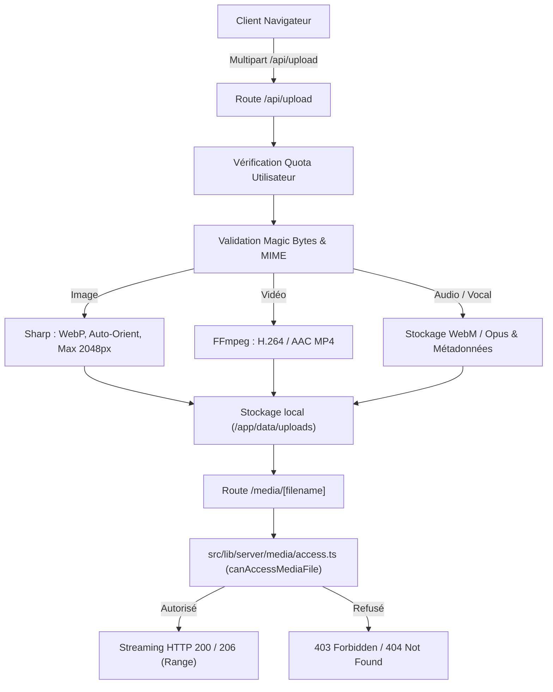

L'application gère une grande variété de contenus multimédias (photos de posts et carrousels, stories éphémères, vidéos, messages vocaux et packs d'assets vectoriels).

Le système garantit des performances optimales et une sécurité rigoureuse via un pipeline automatisé côté serveur et un contrôle d'accès unifié.

---

## 1. Vue d'Ensemble du Flux



---

## 2. Traitement des Formats

### Images (Sharp)
- **Format cible** : WebP haute fidélité avec compression adaptative.
- **Normalisation** : Orientation EXIF automatique via `.rotate()`.
- **Dimensions maximales** : Redimensionnement proportionnel (max 2048x2048px).
- **Sanitisation SVG** : Les icônes vectorielles sont assainies pour exclure les balises `<script>`, événements inline (`onload`, `onerror`) et URLs externes non sécurisées.

### Vidéos (FFmpeg)
- **Transcodage** : Conversion conteneur MP4 avec codec vidéo H.264 (`libx264`) et audio AAC (`aac`).
- **Support Streaming & Range Requests** : Le flag `+faststart` place l'atome `moov` au début du fichier MP4 pour permettre la lecture instantanée sans attendre le téléchargement complet.
- **Streaming partiel** : La route `/media/[filename]` prend en charge les requêtes HTTP `Range` (`206 Partial Content`) pour les sauts dans la timeline vidéo.

### Messages Vocaux & Audio
- **Capture côté client** : Enregistrement micro via l'API `MediaRecorder` au format Opus/WebM.
- **Lecteur personnalisé (`VoiceMessagePlayer.svelte`)** : Affichage d'une forme d'onde dynamique, durée totale et position de lecture interactive.

---

## 3. Contrôle d'Accès & Sécurité (`canAccessMediaFile`)

Toute requête vers `/media/[filename]` passe obligatoirement par la fonction `canAccessMediaFile` définie dans `src/lib/server/media/access.ts`.

### Principe Fail-Close
Par défaut, aucun fichier n'est accessible publiquement tant que sa légitimité n'a pas été formellement établie en base de données.

```typescript
// Signature de la fonction centrale
export async function canAccessMediaFile(
  filename: string,
  viewerId: string | null,
  fileMtimeMs: number
): Promise<{ allowed: boolean; isPublicImmutable?: boolean }>;
```

### Règles de Confidentialité Vérifiées :
1. **Médias Publics Immutables** :
   - Avatars utilisateurs publics.
   - Packs d'icônes ou d'émojis partagés ou activés par l'instance.
   - En-tête de réponse : `Cache-Control: public, max-age=31536000, immutable`.
2. **Médias de Publications (`Post`)** :
   - Liés aux permissions du post : public, réservé aux abonnés (`followers`), restreint à un groupe d'amis (`group`), ou privé.
   - Les utilisateurs bloqués ou dont le compte n'a pas été accepté ne peuvent pas charger le média.
3. **Stories Éphémères** :
   - Accessibles uniquement si la story n'est pas expirée (< 24h) et si le spectateur remplit les conditions de visibilité.
4. **Fichiers & Vocaux de Messagerie (`Chat`)** :
   - Accessibles strictement aux participants membres de la conversation.
5. **Fenêtre de Grâce pour Brouillons (Upload récent)** :
   - Un utilisateur authentifié venant d'uploader un fichier dispose d'une fenêtre de 2 heures pour l'associer à une publication ou une story avant que le fichier non référencé ne soit automatiquement verrouillé puis nettoyé.

---

## 4. Quotas de Stockage Utilisateur

Chaque utilisateur dispose d'une allocation maximale d'espace disque (ex: 500 Mo par défaut, paramétrable dans l'instance).

- **Calcul en temps réel** : La somme des tailles des médias stockés pour les posts, stories, messages de chat et packs personnalisés est agrégée.
- **Gestion dans les paramètres** : Le panneau `SettingsMedia.svelte` (`StorageQuotaCard.svelte`) affiche une barre de progression claire et propose des actions de suppression ciblées par catégorie pour libérer de l'espace.
