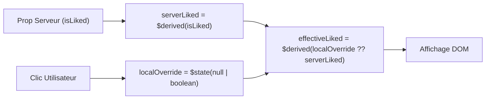

Dans une application sociale moderne, la latence perçue doit être nulle : un clic sur **Like**, la modification d'un **toggle de confidentialité** ou l'ajout d'un **commentaire** doit se refléter immédiatement à l'écran, avant même la réponse du serveur.

Cependant, dans Svelte 5, synchroniser les props serveur avec un état local mutable peut facilement créer des boucles réactives ou des avertissements de type `state_referenced_locally`.

Pour résoudre cela de manière élégante et prédictible, le projet applique le **Pattern de Fusion Dérivée**.

---

## Le Problème Classique

Considérons une approche naïve :

```svelte
<!-- ❌ ANTI-PATTERN : Risque de désynchronisation et cascades -->
<script lang="ts">
  let { isLiked = false, count = 0 } = $props();

  let localLiked = $state(isLiked); // Avertissement Svelte 5 : capture la valeur initiale uniquement !
  let localCount = $state(count);

  // Obligation d'ajouter un $effect pour surveiller les props si elles changent côté serveur :
  $effect(() => {
    localLiked = isLiked; // Déclenche des re-rendus en cascade et des flashs UI
    localCount = count;
  });
</script>
```

---

## La Solution : Le Pattern de Fusion Dérivée

Le pattern de fusion dérivée sépare explicitement trois notions :
1. **La Vérité Serveur** (`$derived`) : Reflète fidèlement la prop serveur.
2. **Le Delta Optimiste Local** (`$state`) : Ne stocke que la modification temporaire (`null` par défaut).
3. **La Valeur Effective** (`$derived`) : Fusionne les deux. Si une modification locale est active, elle prévaut ; sinon, la valeur serveur est affichée.



---

## Exemple Réel : `LikeButton.svelte`

Voici l'implémentation complète utilisée dans l'application :

```svelte
<script lang="ts">
  let { postId, initialLiked = false, initialCount = 0, username } = $props();

  // 1. Vérité Serveur (Réactive aux réactualisations SSR)
  let serverLiked = $derived(Boolean(initialLiked));
  let serverCount = $derived(Number(initialCount));

  // 2. Dérogation optimiste locale (null = aucune opération en cours)
  let optimisticLiked = $state<boolean | null>(null);
  let optimisticDelta = $state<number>(0);

  // 3. Fusion dérivée (La valeur affichée à l'écran)
  let isLiked = $derived(optimisticLiked !== null ? optimisticLiked : serverLiked);
  let count = $derived(serverCount + optimisticDelta);

  let isSubmitting = $state(false);

  async function handleToggle() {
    if (isSubmitting) return;

    // A. Mise à jour instantanée de l'UI
    const targetLiked = !isLiked;
    optimisticLiked = targetLiked;
    optimisticDelta += targetLiked ? 1 : -1;
    isSubmitting = true;

    try {
      // B. Appel API en arrière-plan
      const res = await fetch(`/api/posts/${postId}/like`, {
        method: targetLiked ? 'POST' : 'DELETE'
      });

      if (!res.ok) throw new Error('Échec API');
      // En cas de succès, on laisse la valeur optimiste jusqu'au prochain rafraîchissement
    } catch (err) {
      // C. Rollback instantané en cas d'erreur
      optimisticLiked = null;
      optimisticDelta = 0;
      alert('Impossible de modifier le like');
    } finally {
      isSubmitting = false;
    }
  }
</script>

<button onclick={handleToggle} class:liked={isLiked}>
  ❤️ {count}
</button>
```

---

## Avantages Clés

- **Zéro `$effect`** : Aucune cascade d'effets secondaires ni cycles de re-rendu infinis.
- **Rollback Transparent** : Pour annuler l'action en cas d'erreur réseau, il suffit de réassigner l'override à `null`. L'affichage rebascule instantanément sur la vérité serveur.
- **Résilience aux InvalidationAll** : Quand SvelteKit recharge les données (`invalidateAll()`), `serverLiked` s'actualise automatiquement, assurant une cohérence totale.
