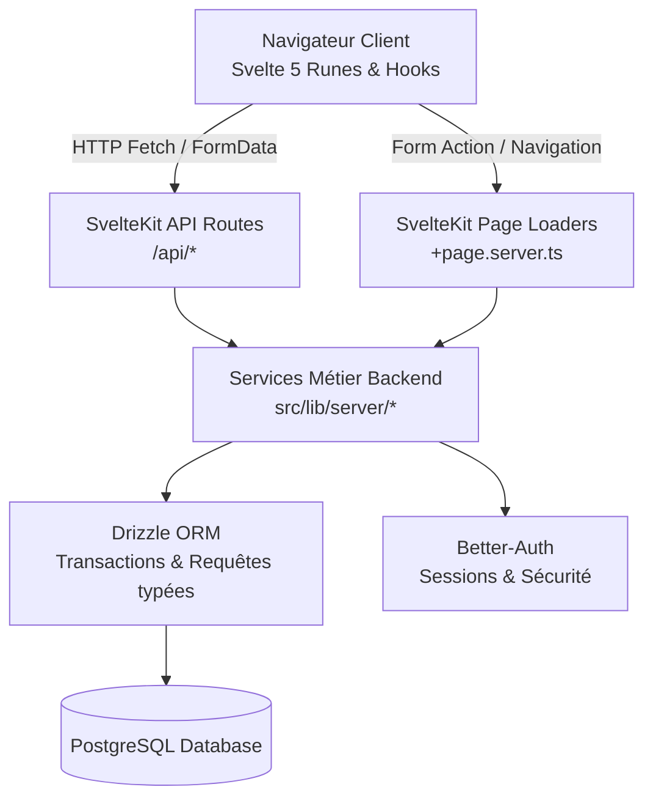

L'application est conçue selon une architecture modulaire, performante et typée de bout en bout, reposant sur **SvelteKit 2** et **Svelte 5**.



## Pile Technologique

| Couche | Technologie | Rôle |
| :--- | :--- | :--- |
| **Framework Web** | SvelteKit 2 | Routing hybride (SSR, CSR), endpoints API, layouts imbriqués |
| **Composants & Réactivité** | Svelte 5 (Runes) | Runes `$state`, `$derived`, `$props`, UI optimiste |
| **Base de Données** | PostgreSQL 16+ | Données relationnelles, contraintes d'intégrité, transactions |
| **ORM** | Drizzle ORM | Schémas TypeScript, requêtes type-safe, migrations |
| **Authentification** | Better-Auth | Sessions cookie sécurisées, mot de passe hashé, rôles |
| **Tests E2E** | Playwright | Parcours complets multi-utilisateurs et assertions DOM |
| **Documentation** | Astro Starlight | Documentation interactive, guides et spécifications API |

## Organisation des Répertoires

```
social_front/
├── docs/                      # Site de documentation Astro Starlight
│   ├── src/content/docs/      # Pages de documentation (Markdown / MDX)
│   └── astro.config.mjs       # Configuration Starlight
├── src/
│   ├── lib/
│   │   ├── client/            # Logique & hooks réactifs côté client (useFeed, searchMemory, etc.)
│   │   ├── components/        # Composants UI découpés & réutilisables (Modal, Post, LikeButton, etc.)
│   │   │   └── settings/      # Composants dédiés aux pages de réglages
│   │   ├── server/            # Services métier backend stricts (chat, follows, comments, posts, db)
│   │   │   └── db/            # Schéma Drizzle SQL & initialisation du pool PostgreSQL
│   │   ├── constants.ts       # Constantes partagées (pagination, tailles, seuils)
│   │   └── types.ts           # Types TypeScript globaux (PostData, ChatMessage, UserGroup)
│   └── routes/                # Pages SvelteKit et endpoints REST (/api/*)
└── tests/                     # Tests End-to-End Playwright (chat, feed, settings, admin)
```

## Principes Directeurs

1. **Aucun SQL dans les routes** : Les fichiers `+page.server.ts` et `+server.ts` agissent comme de fins contrôleurs. Toute la logique SQL et les transactions résident dans `$lib/server/`.
2. **Symétrie Client/Serveur** : Les fonctionnalités accessibles depuis les pages SSR ont un miroir REST dans `/api/` pour les interactions dynamiques (Likes, Commentaires, Abonnements, Visibilité).
3. **Réactivité Déclarative** : Proscription des cascades de `$effect` pour la synchronisation de props. Utilisation stricte du pattern de fusion dérivée.
