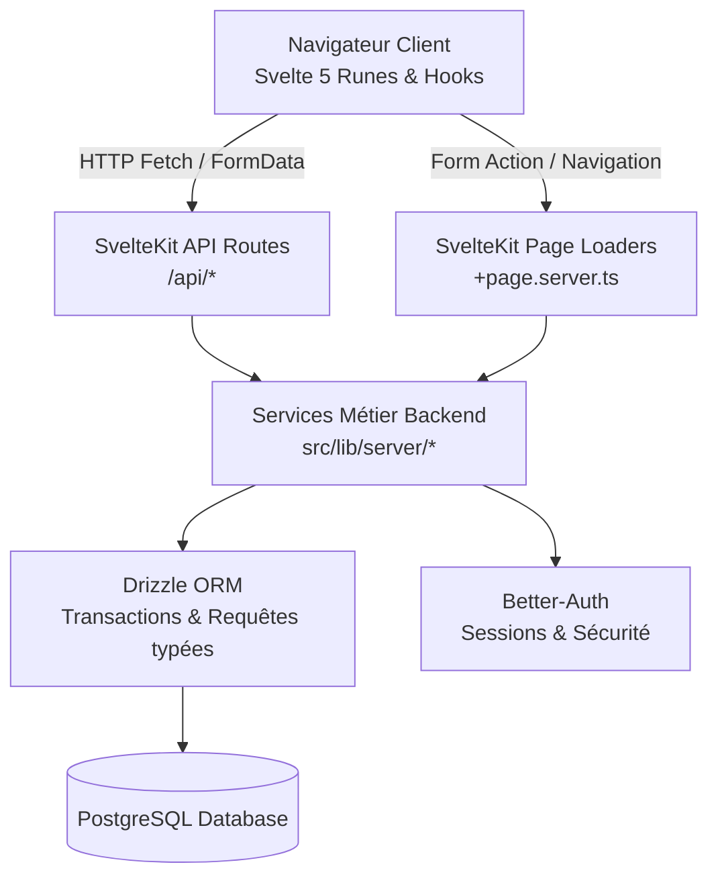

L'application est conçue selon une architecture modulaire, performante et typée de bout en bout, reposant sur **SvelteKit 2** et **Svelte 5**.



## Pile Technologique

| Couche | Technologie | Rôle |
| :--- | :--- | :--- |
| **Framework Web** | SvelteKit 2 | Routing hybride (SSR, CSR), endpoints API, layouts imbriqués |
| **Composants & Réactivité** | Svelte 5 (Runes) | Runes `$state`, `$derived`, `$props`, UI optimiste |
| **Base de Données** | PostgreSQL 16+ | Données relationnelles, contraintes d'intégrité, transactions |
| **ORM** | Drizzle ORM | Schémas TypeScript, requêtes type-safe, migrations |
| **Authentification** | Better-Auth | Sessions cookie sécurisées, mot de passe hashé, rôles |
| **Tests E2E** | Playwright | Parcours complets multi-utilisateurs et assertions DOM |
| **Documentation** | Astro Starlight | Documentation interactive, guides et spécifications API |

## Organisation des Répertoires

```
social_front/
├── docs/                      # Site de documentation Astro Starlight
│   ├── src/content/docs/      # Pages de documentation (Markdown / MDX)
│   └── astro.config.mjs       # Configuration Starlight
├── src/
│   ├── lib/
│   │   ├── client/            # Logique réactive côté client (api.ts, feedMemory, emojiStore, mediaEditorState)
│   │   ├── components/        # Composants UI modulaires découpés par domaine métier :
│   │   │   ├── admin/         # Panneau d'administration modulaire (onglets, statistiques, modération)
│   │   │   ├── chat/          # Messagerie instantanée, lecteur vocal et bulles de messages
│   │   │   ├── comments/      # Volet de commentaires, compositeur et rendu hiérarchique
│   │   │   ├── media-editor/  # Modale de retouche d'image, dessin canvas et styles typographiques
│   │   │   ├── navigation/    # Menus de navigation, notifications en temps réel
│   │   │   ├── post/          # Publication, carrousels de diapositives, en-têtes et éditeur
│   │   │   ├── profile/       # En-tête de profil, onglets et bouton d'abonnement
│   │   │   ├── settings/      # Panneaux de paramètres (stockage, flux, émojis, icônes, confidentialité)
│   │   │   ├── stories/       # Lecteur immersif de stories et compositeur éphémère
│   │   │   └── ui/            # Primitives transversales (Modal, SearchInput, Icon, EmojiButton)
│   │   ├── server/            # Modules de logique métier backend stricts :
│   │   │   ├── admin/         # Seeding et maintenance d'administration
│   │   │   ├── chat/          # Gestion des conversations, messages et autorisations
│   │   │   ├── customPacks/   # Helpers partagés pour les packs d'émojis et d'icônes
│   │   │   ├── db/            # Schémas Drizzle SQL modularisés & pool PostgreSQL
│   │   │   ├── media/         # Traitement d'upload Sharp/FFmpeg, contrôle d'accès et purge
│   │   │   ├── posts/         # Flux composites (blend), tri SQL, publication et recherche
│   │   │   ├── rss/           # Analyseur XML, fetcher sécurisé et synchronisation
│   │   │   ├── stories/       # Cycle de vie des stories (crud, flux, interactions)
│   │   │   ├── auth.ts        # Validation de sessions Better-Auth et guards d'API
│   │   │   ├── comments.ts    # Service de commentaires et réponses hiérarchiques
│   │   │   ├── follows.ts     # Abonnements, approbations et relations
│   │   │   ├── permissions.ts # Contrôle d'accès fail-close et liste de blocage
│   │   │   └── flux.ts        # Configuration des flux composites et parsing
│   │   ├── constants.ts       # Constantes partagées (pagination, quotas, limites)
│   │   └── types.ts           # Types TypeScript globaux
│   └── routes/                # Pages SvelteKit et endpoints REST (/api/*)
└── tests/                     # Suites de tests automatisés Playwright (e2e) et Vitest (unitaires)
```

## Principes Directeurs

1. **Aucun SQL dans les routes** : Les fichiers `+page.server.ts` et `+server.ts` agissent comme de fins contrôleurs. Toute la logique SQL et les transactions résident dans `$lib/server/`.
2. **Symétrie Client/Serveur** : Les fonctionnalités accessibles depuis les pages SSR ont un miroir REST dans `/api/` pour les interactions dynamiques (Likes, Commentaires, Abonnements, Visibilité).
3. **Réactivité Déclarative** : Proscription des cascades de `$effect` pour la synchronisation de props. Utilisation stricte du pattern de fusion dérivée.
